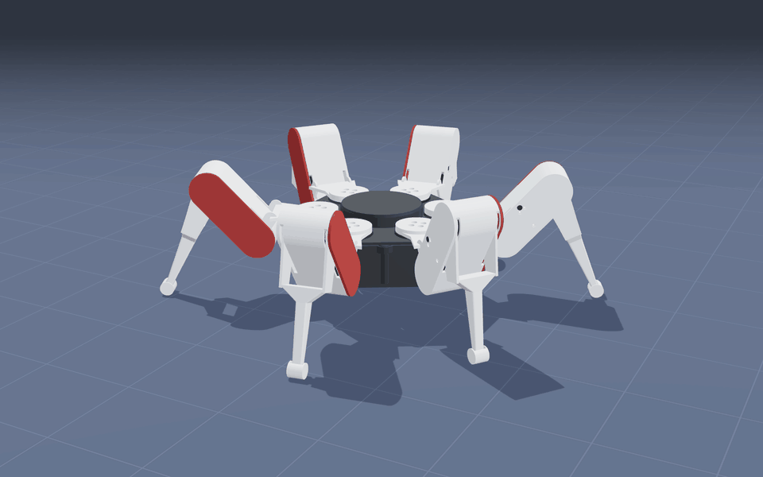
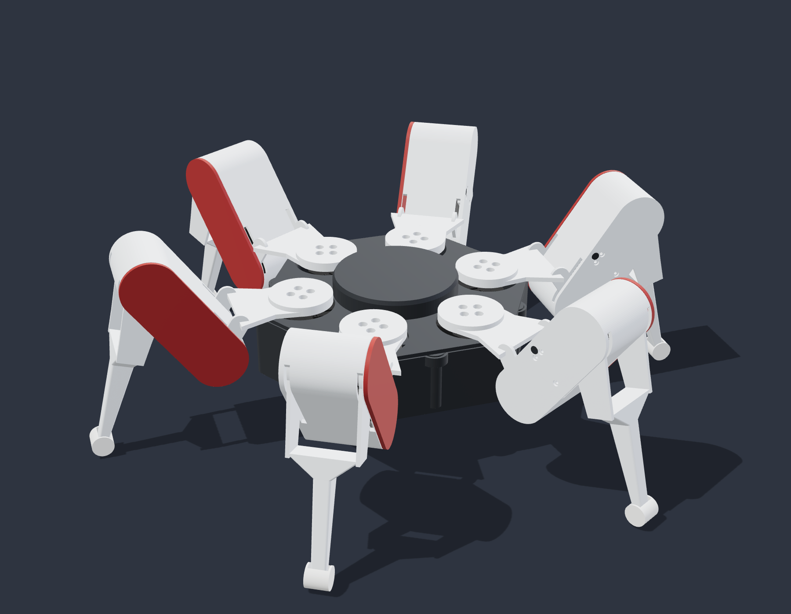
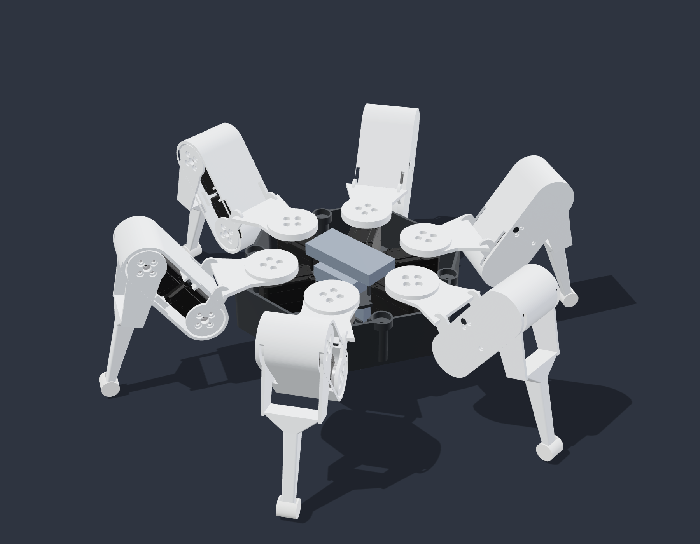
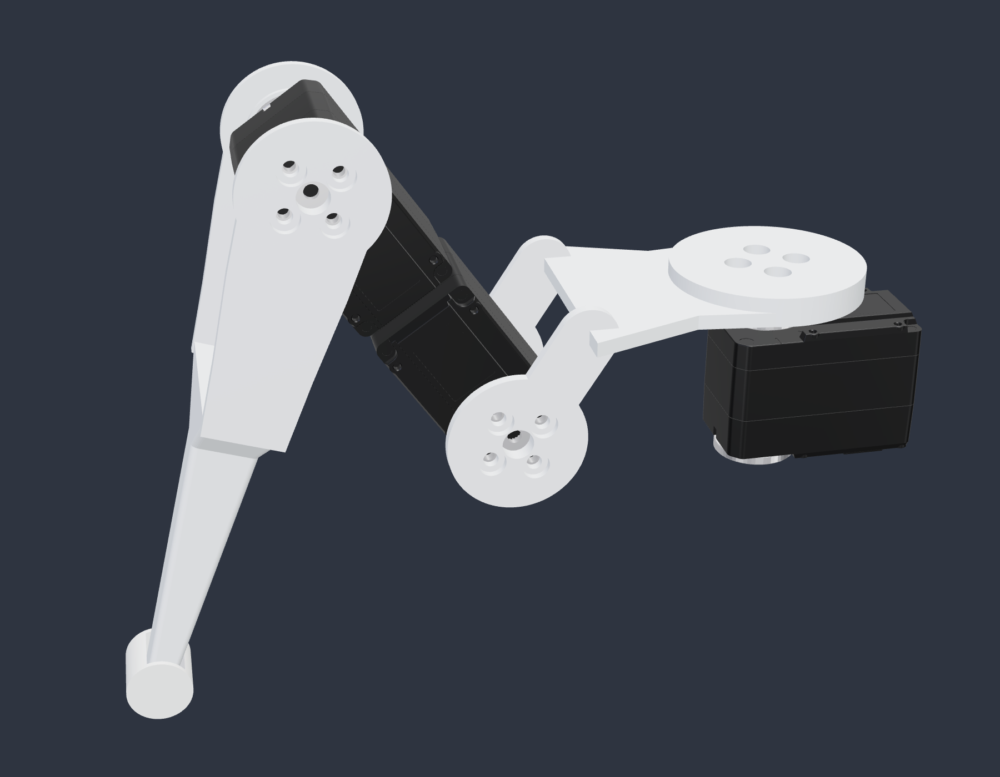
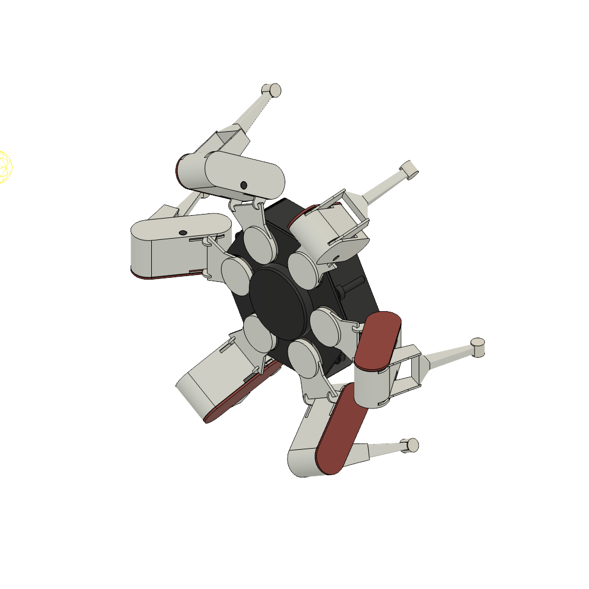
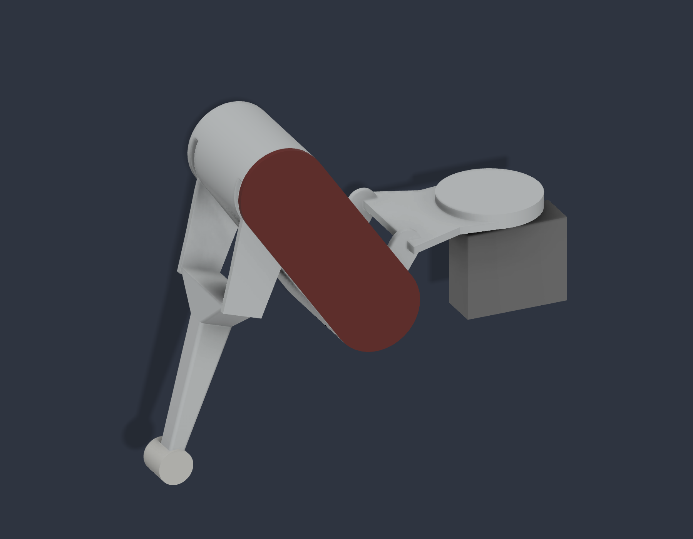

# hx18-hexapod

An 18-joint hexapod robot. The current design, **[`final-concept-st3215/`](final-concept-st3215)**, is the final concept with a real Waveshare ST3215 serial bus servo in every joint. The concept itself is in [`final-concept/`](final-concept), the first MG90S build plan in [`v2/`](v2).

  
  

The printed parts can be viewed in 3D on GitHub: [`final-concept-st3215/hx18-final-concept-st3215-printed-parts.stl`](final-concept-st3215/hx18-final-concept-st3215-printed-parts.stl).

## Final concept with ST3215

- Same parts, shapes, colours and pose as the final concept, scaled 1.4× so the ST3215 fits: the concept only reserved a 32 × 27 × 13 mm envelope per joint.
- 18 × Waveshare ST3215 (30 kg·cm at 12 V, serial bus). Every servo in the model is Waveshare's official 3D model.
- Hip and knee servo sit back to back inside the closed femur, behind the red cover. The six yaw servos are in the core.
- Stands about 443 × 391 mm with the body 44 mm off the ground; about 1.0 kg of plastic if printed solid.
- Generated by Python ([CadQuery](https://github.com/CadQuery/cadquery)) from the concept's own Fusion script, and checked in software: no overlapping parts, no contact over the concept's joint ranges or during the tripod gait in the GIF. Details, servo IDs and print settings in [`final-concept-st3215/README.md`](final-concept-st3215/README.md).

| Path in `final-concept-st3215/` | Contents |
|---|---|
| `hx18-final-concept-st3215.step` | Whole robot with the 18 servos, coloured, for Fusion 360 or any CAD tool |
| `STL/` | The 8 print parts, in mm |
| `PRINT-BOM.csv` | Quantity, material, colour and volume per part |
| `HARDWARE-BOM.csv` | Servos, screws, inserts and electronics |
| `VALIDATION.json` | Interference and joint range checks |
| `renders/` | The pictures |
| `generator/` | The Python generator and its tests |

### Printing

Bambu Lab P1S, 0.4 mm nozzle, 0.2 mm layers. PETG for the core, coxa, femur and tibia, PLA for the red covers, TPU 95A for the foot pads. Not test-printed yet.

### Status

CAD done and checked in software. Nothing printed and no firmware for the ST3215 bus yet: the [`v2/`](v2) firmware drives MG90S servos through PCA9685 boards. Next: print one leg and test it on the bench.

## Previous versions

**[`final-concept/`](final-concept)** — the Fusion 360 design, with a reserved envelope in every joint instead of a real actuator. Built by a Fusion script ([`Automation/HexapodV5`](final-concept/Automation/HexapodV5)); its form was inspired by [ManufacturedMotion/Hex](https://github.com/ManufacturedMotion/Hex), with geometry modelled from scratch.

  
  

**[`v2/`](v2)** — the first build plan: 18 × MG90S, an Adafruit Feather ESP32 V2 with two PCA9685 PWM drivers, full wiring and an Arduino firmware with host tests (FK/IK, gait, safety interlocks; ASan/UBSan). Build guide in `v2/START-AICI.md` (Romanian).

## License

[MIT](LICENSE), except the Waveshare ST3215 model in [`vendor/`](vendor), which belongs to Waveshare.
