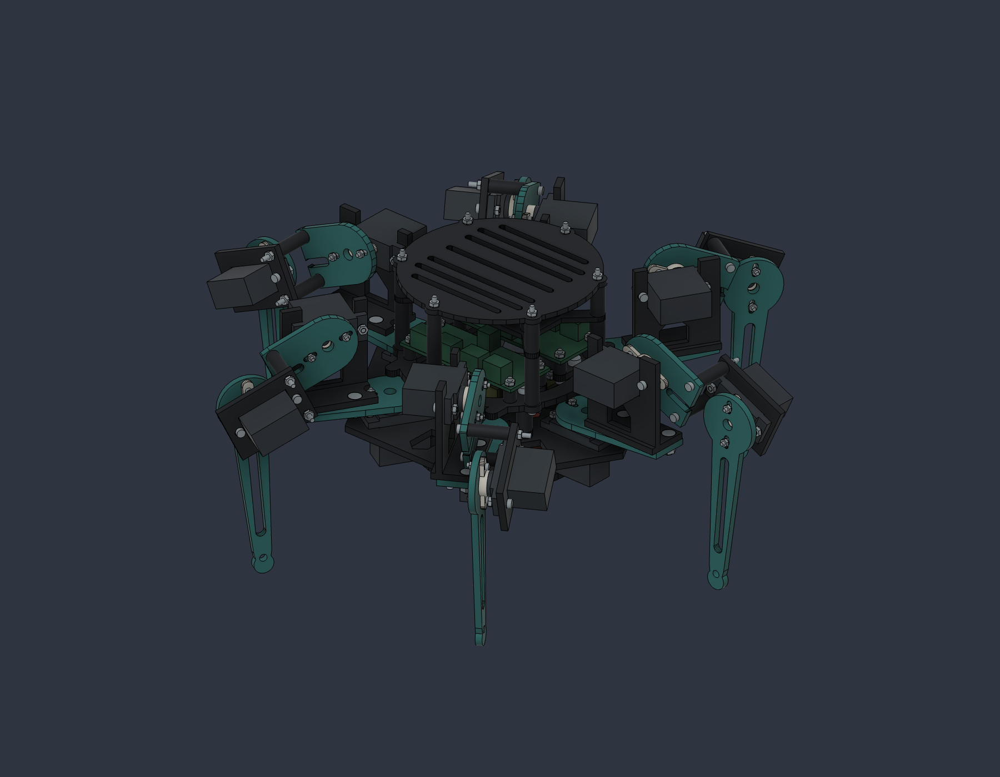
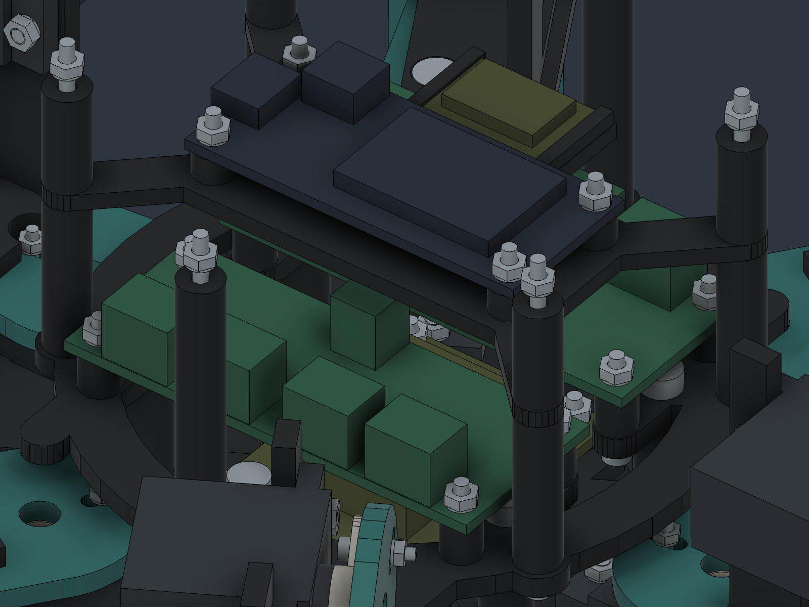
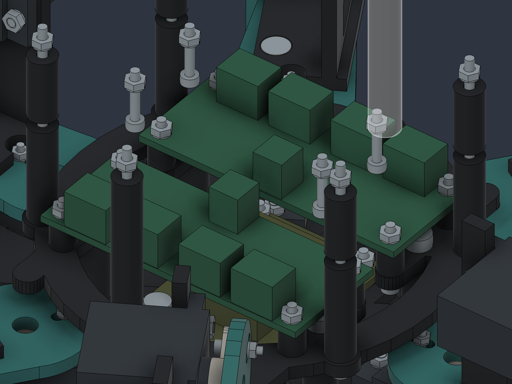

# hx18-hexapod

An 18-servo hexapod robot with an ESP32 controller: Fusion 360 model, print-ready STLs, wiring and firmware.



<p>
  
  
</p>

## Design

- Six identical legs with three joints each (yaw / hip / knee) — 18 × TowerPro MG90S servos.
- Built up from my original leg sketch (`Original-Sketch.f3d`), kept untouched in the repo.
- Fusion 360 assembly with 154 instances and 18 revolute joints, so the legs can be moved in CAD.
- 17 distinct printed parts, 58 pieces in total, plus a fit-test coupon. No printed threads or splines.
- Electronics core in the middle of the chassis: Adafruit Feather ESP32 V2, two PCA9685 16-channel PWM drivers, separate 5 V regulators for the servo bus and for logic, a 2S 450 mAh LiPo, fuse and a removable cover.

## Files

| Path | Contents |
|---|---|
| `HX18-MG90S.f3d` | Fusion 360 assembly with joints — the source of truth |
| `HX18-MG90S.step` | Geometry for any other CAD tool (no joints) |
| `STL/` | Print-ready parts in mm, already oriented flat on the bed |
| `Electronics/` | Electronics BOM, wiring diagram (`wiring.svg`) and wiring/calibration guide |
| `Firmware/` | ESP32 firmware (Arduino), host tests, serial console |
| `Automation/` | Fusion 360 API scripts that generate and audit the model |
| `BOM-mechanical.csv` | Screws, nuts and washers |
| `*-validation.json`, `VERIFICARE.md` | CAD, mesh, motion and gait check results |
| `START-AICI.md` | Full build guide — parts table, print order, assembly steps (Romanian) |

## Printing

| Setting | Value |
|---|---|
| Printer | Bambu Lab P1S, 0.4 mm nozzle |
| Layer height | 0.2 mm |
| Walls | 4–5 |
| Top / bottom layers | 5 |
| Infill | 25–35 % |
| Material | PLA or PETG — not test-printed yet |

1. Print `STL/FitCoupon.stl` first, unscaled, and check a real MG90S in the 23.4 × 13.0 mm opening, the horn and the screw access.
2. Print and assemble **one leg** before printing the rest.
3. The largest part is the chassis (138 × 119.5 mm). Use a brim on `GuardTall` (40 mm tall). Nominal holes: M2 = 2.4 mm, M3 = 3.4 mm.

## Firmware

Arduino firmware for the Feather ESP32 V2 driving both PCA9685 boards over I²C.

- Inverse kinematics and a slow wave gait — one leg in the air at a time, five always planted, with a quintic swing so planted feet are never dragged at different speeds.
- Safety first: boots with every output disabled, and `ARM` stays locked until all 18 servos and both PWM oscillators are calibrated in `config.h`. A missing heartbeat (1.5 s), an I²C error or a stall disables the outputs; a 1 s task watchdog resets a hung loop.
- Joint limits plus speed and acceleration limiting on every command.
- Serial console with `STATUS`, `ARM`, `WALK`, `STOP`, `DISARM` and per-servo bench calibration.

```bash
# host tests (clang++, ASan/UBSan)
sh Firmware/test.sh

# build for the board
arduino-cli compile --fqbn esp32:esp32:adafruit_feather_esp32_v2 Firmware/HX18Controller

# serial console
pip install -r Firmware/requirements.txt
python3 Firmware/serial_console.py /dev/cu.usbserial-XXXX
```

The host tests cover FK↔IK, 360,000 gait targets, the safety interlocks and a simulated walk/stop/restart cycle, with 100 % line coverage of the kinematics core. The firmware compiles for the board (365 KB flash, 25 KB RAM).

## Status

CAD and firmware are done and checked in software. **Not printed or assembled yet** — servo fit, wiring, calibration and the gait under real load still need a physical prototype.

## License

[MIT](LICENSE)
