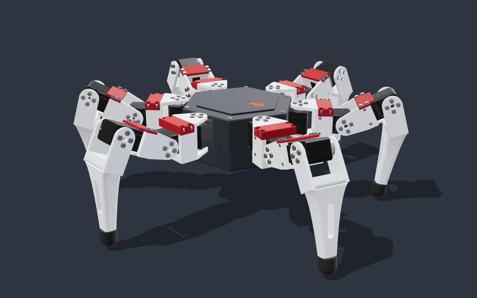
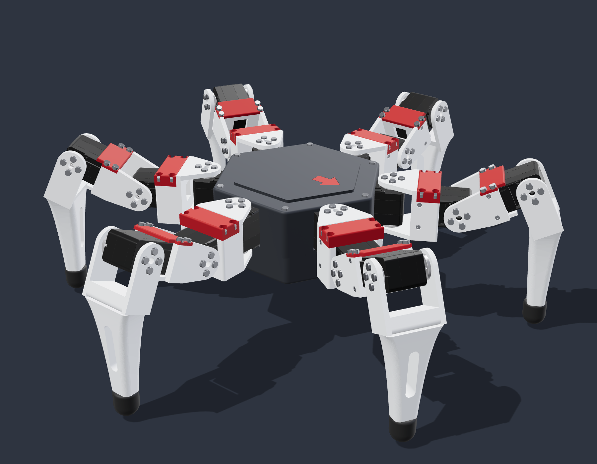
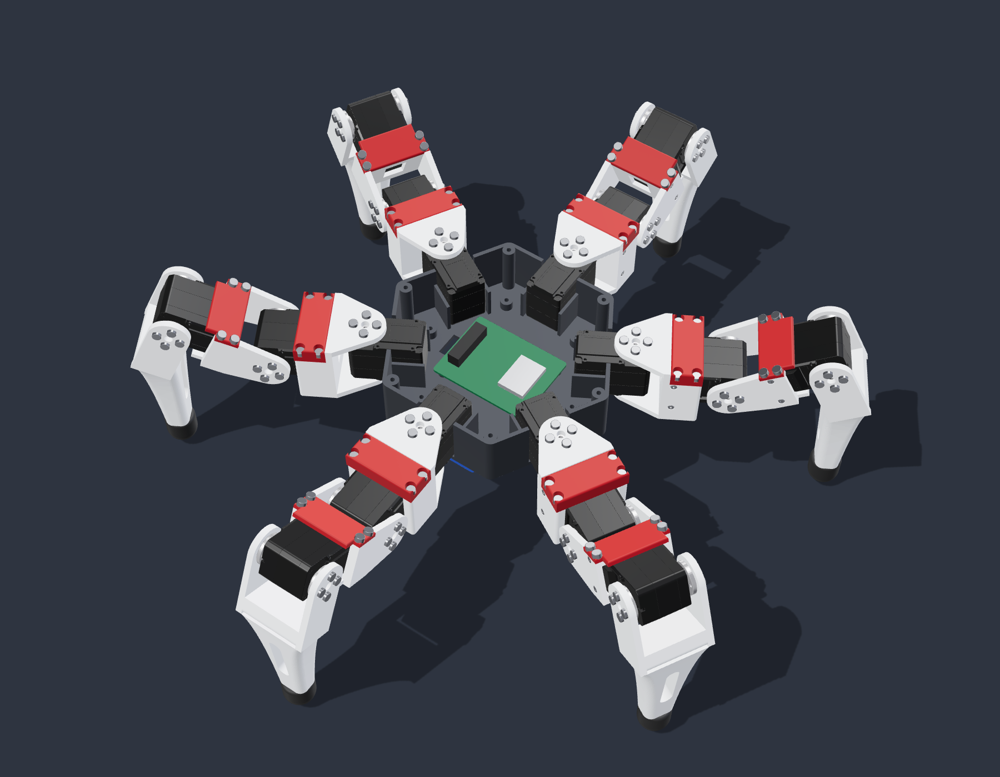

# hx18-hexapod

An 18-joint hexapod robot. The current design, **HX18 ST3215** in [`st3215/`](st3215), uses 18 Waveshare ST3215 serial bus servos. The earlier designs are kept in [`final-concept/`](final-concept) and [`v2/`](v2).

  
  

The printed parts can be viewed in 3D on GitHub: [`st3215/hx18-st3215-printed-parts.stl`](st3215/hx18-st3215-printed-parts.stl).

## HX18 ST3215

- 18 × Waveshare ST3215 (30 kg·cm at 12 V, 360° magnetic encoder, serial bus). Every servo in the model is Waveshare's official 3D model, in its real colours.
- Each joint is held on both sides: one link holds the servo body, both horns are bolted to the next link.
- Hexagonal core with the six yaw servos, an ESP32 bus-servo driver board and a battery bay for a 3S LiPo underneath.
- White structural parts, red removable covers over the hip and knee servos, a red arrow on the lid marks the front.
- Stands about 405 × 440 mm with the body 56 mm off the ground; about 1.1 kg of plastic if printed solid.
- Generated by Python ([CadQuery](https://github.com/CadQuery/cadquery)) and checked in software: no overlapping parts, no collisions over the joint ranges or during a tripod gait. Details and servo IDs in [`st3215/README.md`](st3215/README.md).

| Path in `st3215/` | Contents |
|---|---|
| `hx18-st3215.step` | Whole robot with the 18 servos, coloured, for Fusion 360 or any CAD tool |
| `hx18-st3215-printed-parts.stl` | Printed parts only, as assembled |
| `STL/` | The 10 print parts, oriented for the bed, in mm |
| `PRINT-BOM.csv` | Quantity, material, colour and volume per part |
| `HARDWARE-BOM.csv` | Servos, screws, battery and controller |
| `VALIDATION.json` | Interference, collision and gait check results |
| `renders/` | The pictures and the walking GIF |
| `generator/` | The Python generator, renderer and tests |
| `vendor/` | Waveshare's ST3215 model ([notice](st3215/vendor/NOTICE.md)) |

### Printing

| | |
|---|---|
| Printer | Bambu Lab P1S, 0.4 mm nozzle |
| Parts | 40 pieces from the 10 files in `st3215/STL/` — quantities in `PRINT-BOM.csv` |
| Material | PETG for the core, coxa, femur and tibia; PLA for the red covers; TPU 95A for the toe boots |
| Layer height | 0.2 mm as a starting point |
| Supports | The STLs are already oriented; expect supports under the coxa arms and the tibia shank. Not test-printed yet |

### Status

CAD done and checked in software. Nothing printed yet and there is no firmware for this version: the [`v2/`](v2) firmware drives MG90S servos through PCA9685 boards, not the ST3215 bus. Next: print one leg and test it on the bench.

## Previous versions

**[`final-concept/`](final-concept)** — the Fusion 360 design before the servo was chosen. Every joint had a reserved 32 × 27 × 13 mm envelope instead of a real actuator. Built by a Fusion script ([`Automation/HexapodV5`](final-concept/Automation/HexapodV5)); its form was inspired by [ManufacturedMotion/Hex](https://github.com/ManufacturedMotion/Hex), with geometry modelled from scratch.

  
  

**[`v2/`](v2)** — the first build plan: 18 × MG90S, an Adafruit Feather ESP32 V2 with two PCA9685 PWM drivers, full wiring and an Arduino firmware with host tests (FK/IK, gait, safety interlocks; ASan/UBSan). Build guide in `v2/START-AICI.md` (Romanian).

## License

[MIT](LICENSE), except the Waveshare ST3215 model in `st3215/vendor/`, which belongs to Waveshare.
