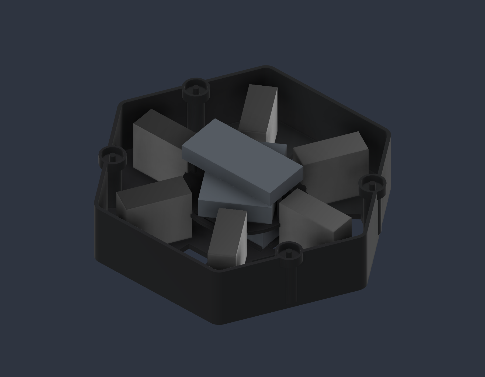

# hx18-hexapod

An 18-joint hexapod robot designed in Fusion 360. **final concept** is the current design; [`v2/`](v2) keeps the earlier MG90S version with complete wiring and ESP32 firmware.


<p>
  
  
</p>

The whole robot can be viewed in 3D on GitHub: [`final-concept/final-concept-assembly.stl`](final-concept/final-concept-assembly.stl).

## final concept

- Six legs with three joints each (yaw, hip, knee) — 18 revolute joints.
- The hip and knee motors sit inside one continuous shell per leg, closed by a red front service panel. The lower arm tapers to a centred blade with a soft toe boot.
- Hexagonal core (about 144 × 126 mm) with a tub, a lid and a removable electronics cassette, with space reserved for the battery, regulator and controller.
- 33 printed pieces from 8 part types, and 12 service screws.
- The actuator is not chosen yet: each joint has a reserved 32 × 27 × 13 mm envelope that the real servo will replace.
- Built by a Python script for Fusion 360 ([`Automation/HexapodV5`](final-concept/Automation/HexapodV5)), then posed and saved as "final concept".
- The form was inspired by [ManufacturedMotion/Hex](https://github.com/ManufacturedMotion/Hex); the geometry is modelled from scratch, with no meshes or CAD copied.

| Path in `final-concept/` | Contents |
|---|---|
| `final-concept.f3d` | Fusion 360 design with joints |
| `final-concept.step` | Geometry for other CAD tools |
| `final-concept-assembly.stl` | Whole robot, printed parts only, as posed |
| `STL/` | The 8 print parts, oriented on the bed, in mm |
| `PRINT-BOM.csv` | Quantities, volumes and proposed orientation per part |
| `Automation/HexapodV5/` | Generator script and its tests |
| `*-validation.json` | CAD, motion, mesh and Python check results |
| `README.ro.md` | Design notes (Romanian) |

## Printing

| | |
|---|---|
| Printer | Bambu Lab P1S, 0.4 mm nozzle |
| Parts | 33 pieces from the 8 files in `STL/` — quantities in `PRINT-BOM.csv` |
| Material | PLA or PETG for the rigid parts, TPU for the toe boots — final choice after a test leg |
| Layer height | 0.2 mm as a starting point |
| Supports | Needed on the lower arm, clevis and upper shell; not tuned yet |

About 360 g of plastic if printed solid. Once the actuator is chosen, print and assemble a single leg first.

The generator's pure-Python tests run without Fusion:

```bash
cd final-concept/Automation/HexapodV5
pip install numpy trimesh
python -m unittest discover    # 36 tests
```

## v2 — MG90S version with firmware

The earlier design: 18 × MG90S servos, an Adafruit Feather ESP32 V2 with two PCA9685 PWM drivers, full wiring and an Arduino firmware with host tests (FK/IK, gait, safety interlocks; ASan/UBSan). Everything is in [`v2/`](v2), with the build guide in `v2/START-AICI.md` (Romanian). The firmware has not been adapted to the final-concept geometry.

## Status

final concept: CAD done and checked in software — 71 joint poses without collisions and closed, single-solid meshes. Next: choose the actuator and print a test leg. Nothing has been printed yet.

## License

[MIT](LICENSE)
