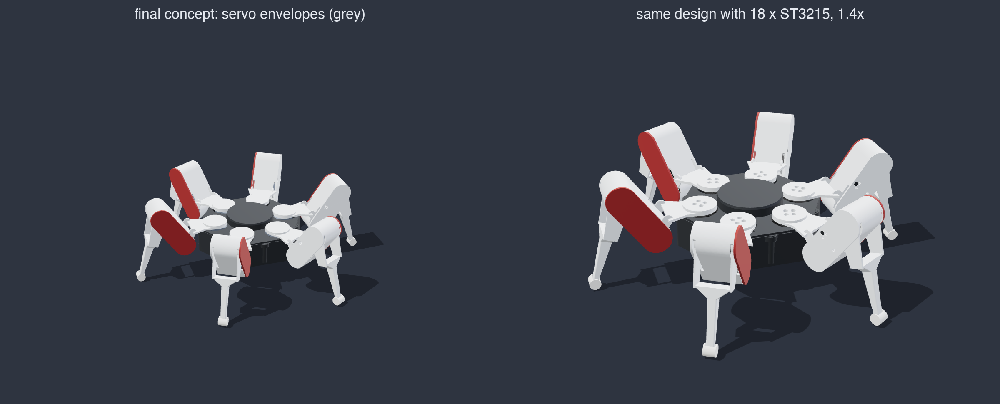
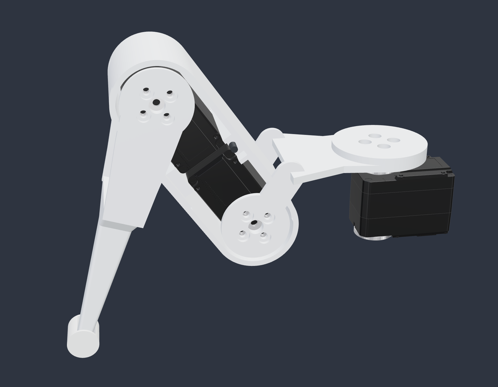
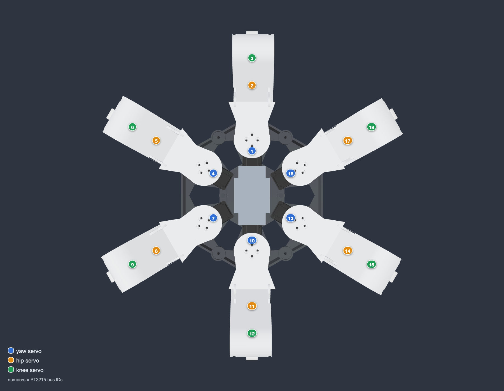

# HX18 final concept with ST3215

The [final concept](../final-concept) with a real Waveshare ST3215 serial bus servo in every one of the 18 joints. The design is the same: same parts, same shapes, same colours, same pose. The concept only reserved a 32 × 27 × 13 mm envelope per joint, and the ST3215 does not fit in that, so the whole robot is scaled up 1.4× and the servo mounts are added inside the parts.




<p>
  
  
</p>

## Why 1.4×

1.4 is the smallest scale at which the ST3215 fits every joint of the concept:

- Hip and knee servo sit back to back in the femur. Each case reaches 35.1 mm from its output axis, so the hip-to-knee distance has to be more than 70.2 mm: 52 mm × 1.4 = 72.8 mm.
- The case corner behind the output axis is 16.0 mm from the axis. The femur capsule's inner radius is 12.2 mm × 1.4 = 17.1 mm.
- The horn faces are 18.6 mm from the servo's centre plane. The concept's pivot plates sit at 14.3 mm × 1.4 = 20.0 mm, with a boss on each plate bridging the gap.

Screws, heat-set inserts and their holes keep their real size.

## What changed inside the parts

On the outside only screw holes are new: four on each yaw disc, three small ones on the back of each femur and the yaw servo screws under the floor.

| Part | Change |
|---|---|
| Coxa | Hub under the yaw disc down to the yaw servo horn (4 × M3). Horn bosses and 4 × M3 on both shoulder plates |
| Femur | Retention bridge moved above the servos, a second one below them. 3 M2 standoffs hold the two cases. The rear cover screw now passes over the servos |
| Red cover | Tongue moved in front of the servos |
| Tibia | Horn bosses and 4 × M3 on both knee plates |
| Core tub | 4 M2 standoffs per yaw servo on the floor. Strap slots and cassette columns moved clear of the servos |
| Cassette | Bays for the yaw servos, supports moved to match. Regulator keep-out reduced to 44 × 44 mm |

The hip servo case rides in the femur and its two horns are bolted to the coxa plates, like the concept's inverted hip. The knee servo case is also in the femur, with its horns on the tibia. The yaw servos are screwed to the tub floor.

## Files

| Path | Contents |
|---|---|
| `hx18-final-concept-st3215.step` | Whole robot with the 18 servos, coloured, for Fusion 360 or any CAD tool |
| `hx18-final-concept-st3215-printed-parts.stl` | Printed parts only, as assembled, to view on GitHub |
| `STL/` | The 8 print parts, in mm, oriented like the concept |
| `PRINT-BOM.csv` | Quantity, material, colour and volume per part |
| `HARDWARE-BOM.csv` | Servos, screws, inserts and electronics keep-outs |
| `VALIDATION.json` | Interference, joint range and fidelity checks |
| `renders/` | The pictures and the walking GIF |
| `generator/` | The Python generator and its tests |

## Servo IDs

Leg *n* uses IDs 3*n*−2 (yaw), 3*n*−1 (hip) and 3*n* (knee). Leg 1 points along +X.



## Size

- About 443 × 391 mm standing, 151 mm tall, body 44 mm off the ground.
- 33 printed parts, about 1.0 kg of plastic if printed solid.

## Printing

| | |
|---|---|
| Printer | Bambu Lab P1S, 0.4 mm nozzle |
| Material | PETG for the core, coxa, femur and tibia; PLA for the red covers; TPU 95A for the foot pads |
| Layer height | 0.2 mm |
| Walls | 3 or more on the coxa, femur and tibia |
| Supports | Needed under the lid rim, the coxa link and the tibia beam, as in the concept |

Nothing has been printed yet. Print one leg first and check the servo fit.

## Checks

From `generator/build.py`, written to [`VALIDATION.json`](VALIDATION.json):

- Exact B-rep intersection of every pair of parts (core and one leg, 33 parts, servos included): no overlaps.
- The concept's joint ranges (yaw ±20°, hip ±12°, knee ±15°) on a 3° grid, 297 poses: no contact.
- Free travel of each joint from the modelled pose: yaw ±50°, hip −27° to +23°, knee −19° to +41°. Hip and knee are limited by the concept's own shapes, the same as at the original size.
- Tripod gait in the GIF, all six legs, 40 frames: no contact. 50 mm per step, feet lifted 18 mm, joints within yaw ±11°, hip −8° to +20°, knee −17° to +15°. Planted feet do not slide; the gait is in `generator/gait.py` (inverse kinematics included).
- With `servo=False` and scale 1, the generator rebuilds the eight concept parts with the volumes Fusion reported for them.

## Generator

The generator ports the Fusion script in [`final-concept/Automation/HexapodV5`](../final-concept/Automation/HexapodV5) to [CadQuery](https://github.com/CadQuery/cadquery) feature by feature, then adds the servo changes.

```bash
cd final-concept-st3215/generator
pip install cadquery trimesh python-fcl pillow
python -m unittest test_hx18     # 9 tests
python build.py                  # STEP, STLs, BOMs, VALIDATION.json

# renders also need Node with three and playwright-core, plus Google Chrome
npm install --prefix /tmp/hx18-render three@0.169.0 playwright-core@1.48.2
HX18_NODE_MODULES=/tmp/hx18-render/node_modules python build.py --renders --gif
```

## Status

CAD done and checked in software. Not printed, no firmware for the ST3215 bus yet. The battery and controller keep-outs are the concept's, scaled; the battery bay (60 × 32 × 18 mm) only takes a small 3S pack, so a first test should run from a bench supply.

The ST3215 model in [`../vendor`](../vendor) is Waveshare's official file ([notice](../vendor/NOTICE.md)).
