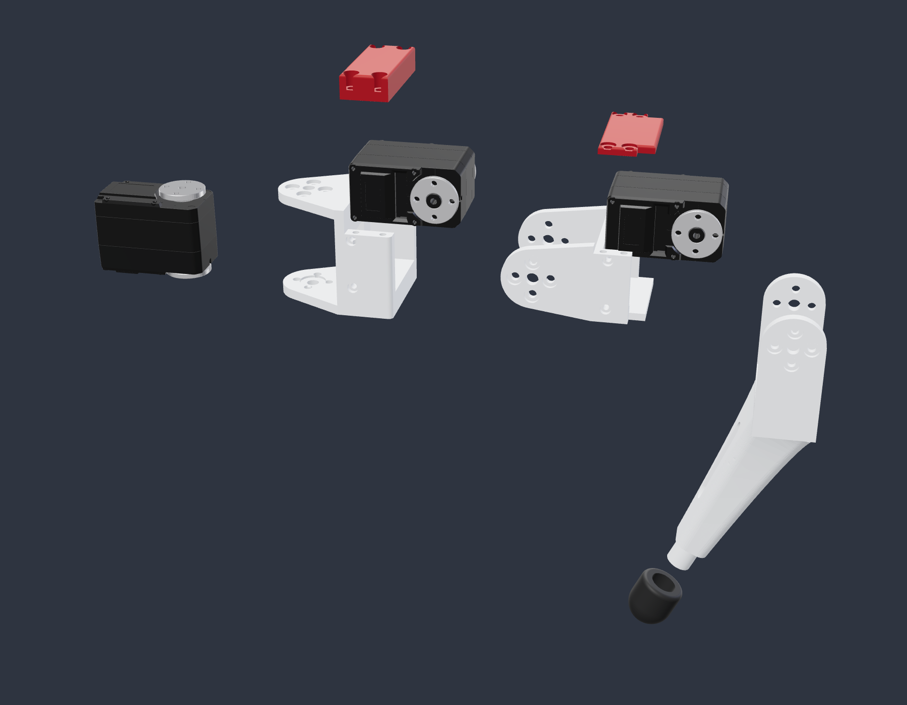
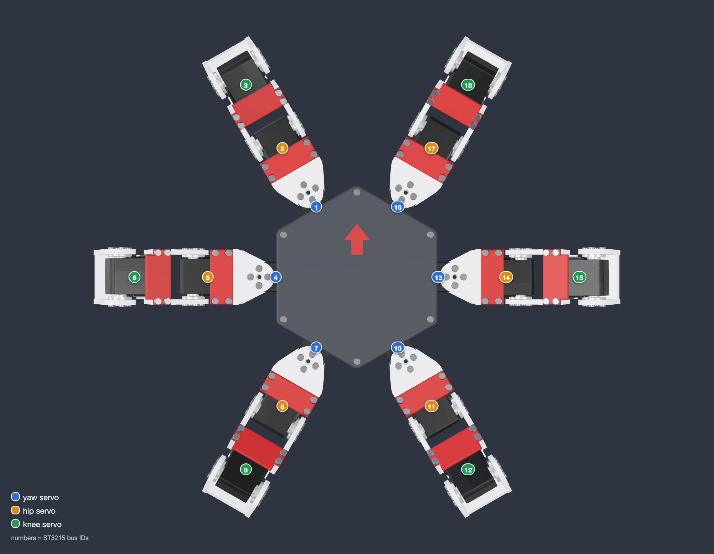

# HX18 ST3215

The current HX18 design: a hexapod with 18 Waveshare ST3215 serial bus servos. The whole model is generated by Python ([CadQuery](https://github.com/CadQuery/cadquery)) around the official ST3215 3D model, so every bracket is sized from the real servo.



## How a leg is built

Every joint uses the same pattern: one link holds the servo body, and both horns (drive and idler) are bolted to the next link, so no joint hangs on a single horn.

| Link | Holds | Bolted to |
|---|---|---|
| Core tub (charcoal) | the 6 yaw servos, screwed through the floor | – |
| Coxa (white) + red cap | the hip servo, dropped in from the top | yaw servo horns, top and bottom |
| Femur (white) + red cover | the knee servo, dropped in from the top | hip servo horns |
| Tibia (white) + TPU toe boot | – | knee servo horns |

The tibia runs straight down to a bend and then turns 25° towards the body. That lets the toe reach under the robot while the knee itself only has to fold 30°.

Red parts are the removable covers: take them off to reach the hip and knee servos.

## Servo IDs

Legs are numbered counter-clockwise from the front left. Leg *n* uses IDs 3*n*−2 (yaw), 3*n*−1 (hip) and 3*n* (knee).

| Leg | Position | Yaw | Hip | Knee |
|---|---|---|---|---|
| 1 | front left | 1 | 2 | 3 |
| 2 | middle left | 4 | 5 | 6 |
| 3 | rear left | 7 | 8 | 9 |
| 4 | rear right | 10 | 11 | 12 |
| 5 | middle right | 13 | 14 | 15 |
| 6 | front right | 16 | 17 | 18 |



## Checks

`generator/build.py` writes the results to [`VALIDATION.json`](VALIDATION.json):

- Exact B-rep intersection of every pair of parts (core + one leg, 90 parts) in the stand pose: no overlaps.
- Collision sweep with the real servo case meshes: yaw at −40°, 0° and +40°, hip −30…+90° and knee −30…+110° in 5° steps (2175 poses): no contact.
- Tripod gait (24 frames, all six legs, 50 mm stride, 28 mm lift): no contact; joints stay within yaw ±11°, hip 21…54°, knee −22…13°.
- Two neighbouring legs turned 25° towards each other: clear.
- All 10 printed parts are single, valid solids.

Out of range: with the femur pointing down past −30° and the knee folded, the tibia touches the body. The firmware should keep the hip above −30°.

## Generator

| File | Contents |
|---|---|
| `servo.py` | Loads the vendor STEP with its colours into a servo frame, plus measured dimensions |
| `layout.py` | Dimensions, joint frames, forward and inverse kinematics |
| `parts.py` | The printed parts |
| `assembly.py` | Places parts, servos, electronics envelopes and screw heads for a pose |
| `gait.py` | Tripod gait used for the animation |
| `checks.py` | Interference check and collision sweep |
| `build.py` | Writes the STEP, STLs, BOMs, validation report and renders |
| `render/` | three.js viewer driven by headless Chrome for the PNG renders |
| `test_hx18.py` | Unit tests |

```bash
cd st3215/generator
pip install cadquery trimesh python-fcl manifold3d pillow
python -m unittest test_hx18            # 8 tests
python build.py                         # CAD, STLs, BOMs, VALIDATION.json

# renders and the walking GIF also need Node with three and playwright-core, plus Google Chrome
npm install --prefix /tmp/hx18-render three@0.169.0 playwright-core@1.48.2
HX18_NODE_MODULES=/tmp/hx18-render/node_modules python build.py --renders --gif
```

## Credits

The ST3215 model in [`vendor/`](vendor) is Waveshare's official file. See [`vendor/NOTICE.md`](vendor/NOTICE.md).
